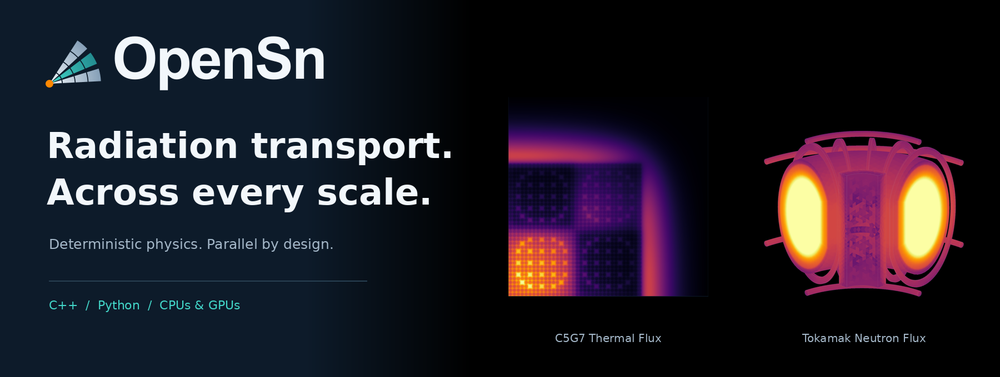
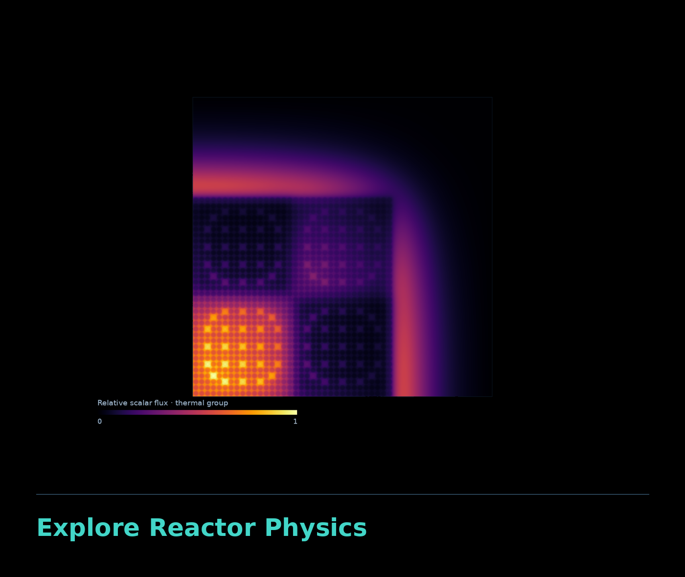
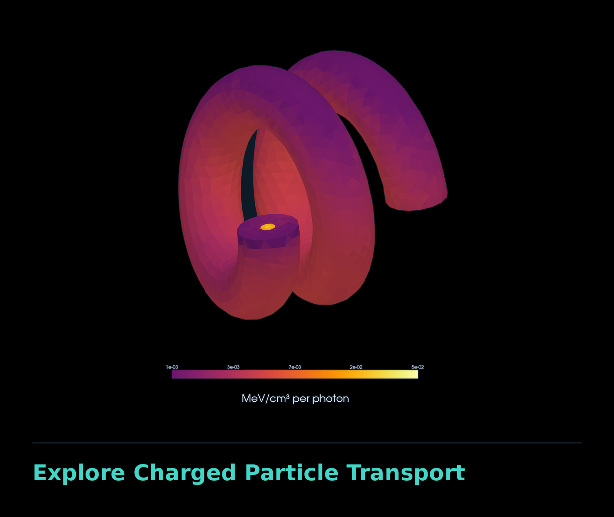
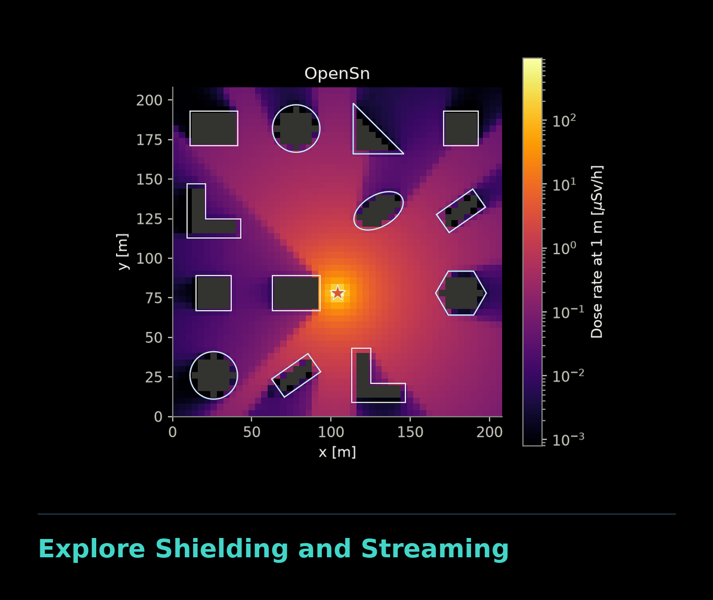
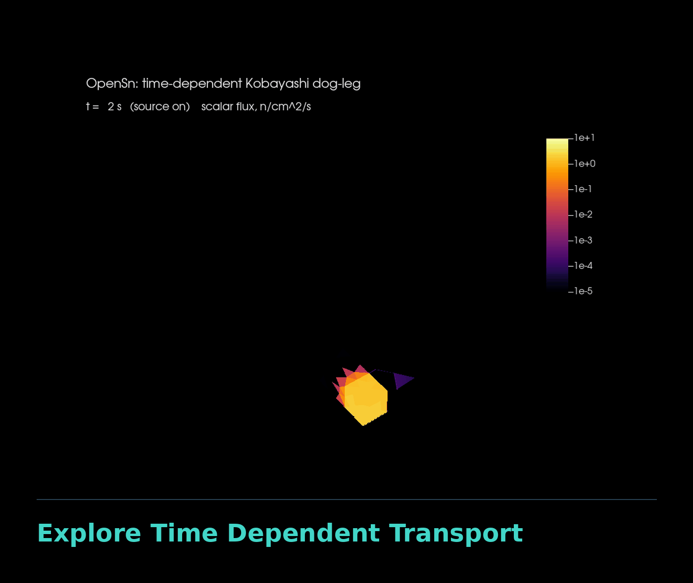
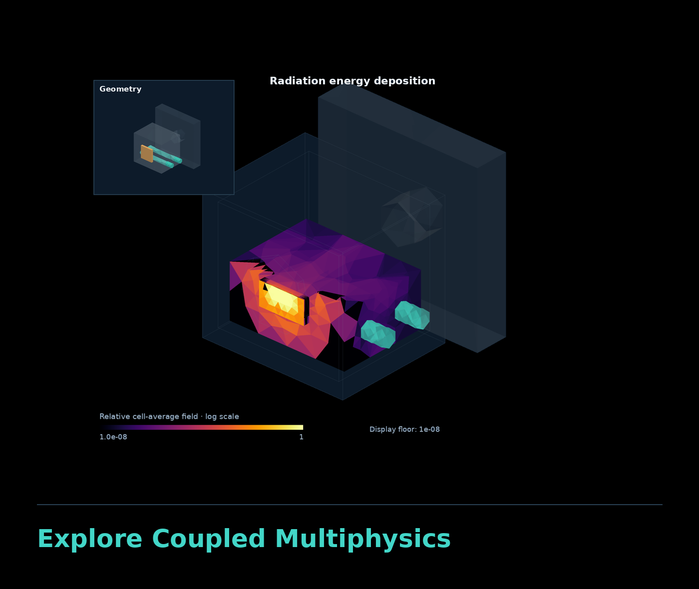
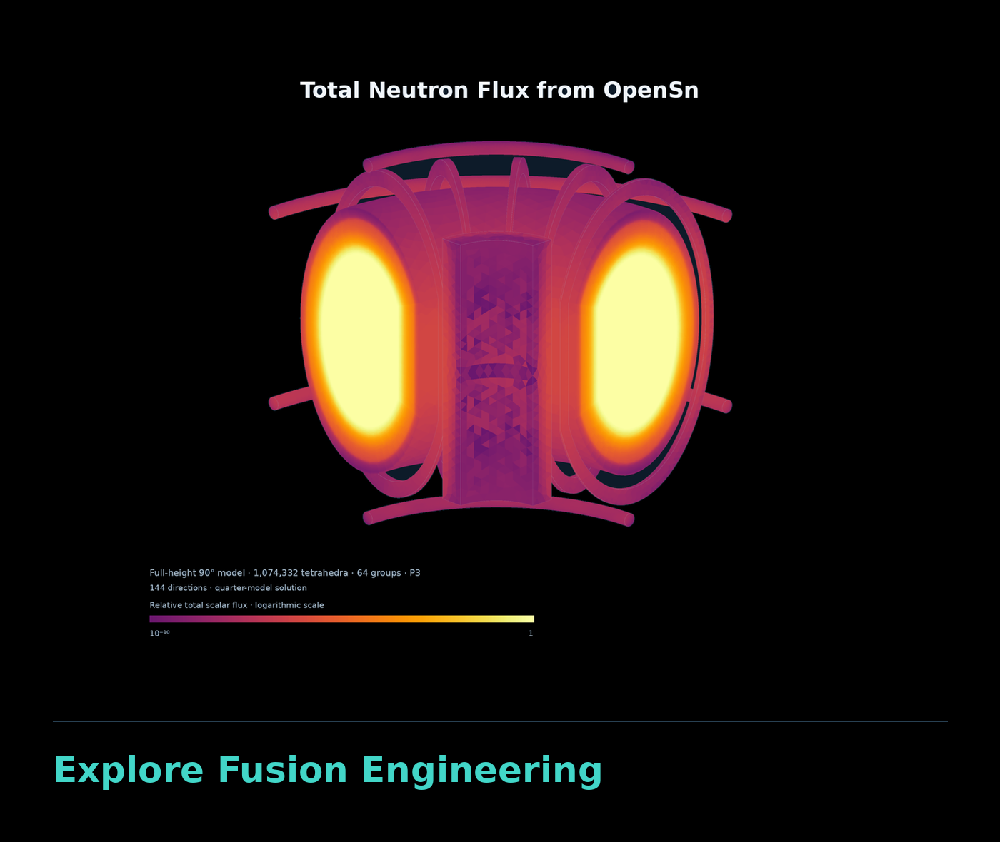

**Open-source, massively parallel radiation transport.** OpenSn solves the
multigroup linear Boltzmann transport equation with the discrete-ordinates
($S_N$) method on structured and unstructured meshes. A modern C++ engine and
Python interface bring reactor physics, shielding, and charged-particle
transport into one simulation workflow—from a laptop to a supercomputer.

[Documentation](https://open-sn.github.io/opensn/) ·
[Installation](https://open-sn.github.io/opensn/install/install.html) ·
[Tutorials](https://open-sn.github.io/opensn/tutorials/index.html) ·
[Examples](https://github.com/Open-Sn/OpenSnExamples) ·
[Discussions](https://github.com/Open-Sn/opensn/discussions)

## See what OpenSn can do...

Below are some examples of the types of problems that OpenSn can solve.

## Capabilities

- **Particle transport:** multigroup neutron and photon transport, coupled
  particle groups, and steady-state CSDA electron/positron transport.
- **Problem types:** steady-state and transient fixed-source problems,
  criticality ($k$-eigenvalue) calculations, and steady-state adjoint responses
  and cross-section sensitivities.
- **Geometry:** 1D, 2D, and 3D discontinuous finite elements on polygonal and
  polyhedral meshes; spherical and axisymmetric curvilinear transport.
- **Angular resolution:** product quadratures and locally refined spherical
  finite-element quadratures; uncollided/first-collision treatments for
  supported point-source problems.
- **Solver acceleration:** Krylov iterative algorithms, diffusion synthetic
  acceleration, SMM, and CMFD.
- **Parallel execution:** MPI domain decomposition and GPU sweep backends for
  CUDA, HIP, and SYCL.
- **Modeling and analysis:** Python scripting and C++ APIs, native/OpenMC/CEPXS
  cross-section readers, restart files, integral responses, and VTK output.

See the [user guide](https://open-sn.github.io/opensn/userguide/index.html) for details.

## Get started

1. **Install OpenSn** using the [installation guide](https://open-sn.github.io/opensn/install/install.html).
2. **Run a small problem** from the [tutorials](https://open-sn.github.io/opensn/tutorials/index.html).
3. **Build on a benchmark** from [OpenSnExamples](https://github.com/Open-Sn/OpenSnExamples),
   including CASL VERA, shielding, and source-driven problems.

OpenSn is developed at Texas A&M University with collaborators and contributors
from the wider radiation-transport community. Questions and modeling discussions
are welcome in [GitHub Discussions](https://github.com/Open-Sn/opensn/discussions).
For bugs, use [Issues](https://github.com/Open-Sn/opensn/issues); for contributions,
start with the [developer workflow](https://github.com/Open-Sn/opensn/blob/main/doc/source/devguide/workflow.rst).

## Cite OpenSn

If OpenSn supports your research, please cite
[Andrs et al., *OpenSn: A Massively Parallel, Open-Source Simulation Environment for Discrete Ordinates Radiation Transport*](https://doi.org/10.1016/j.cpc.2025.110001),
*Computer Physics Communications* **320**, 110001 (2026).
OpenSn is distributed under the [MIT license](https://github.com/Open-Sn/opensn/blob/main/LICENSE).
